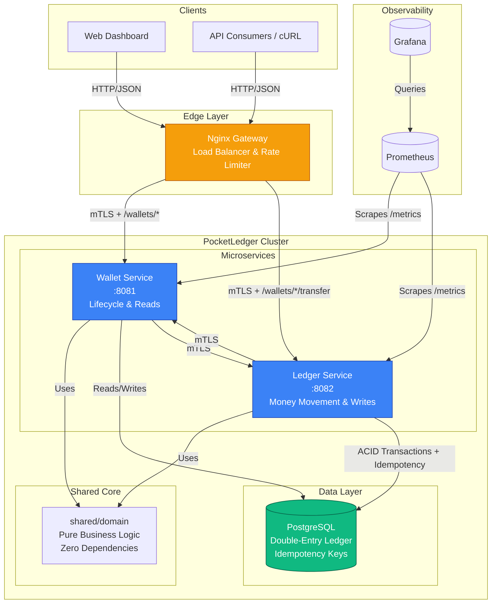
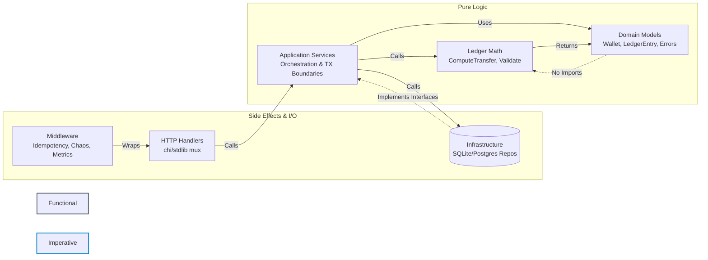
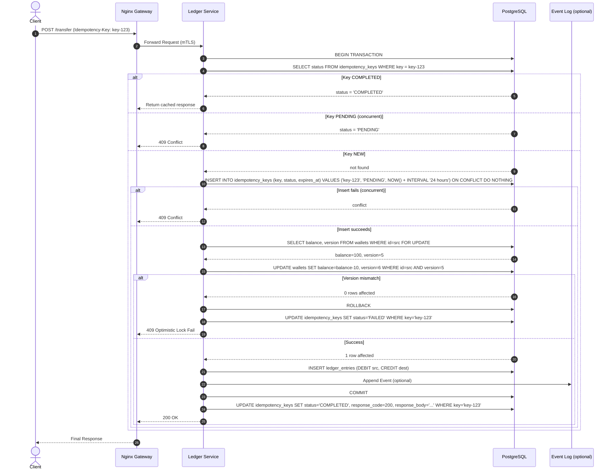
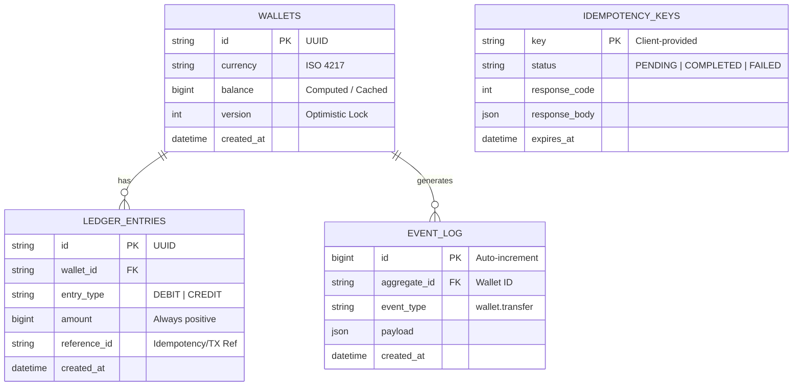

## Architecture & Design

PocketLedger is designed around correctness-first payment principles. The architecture enforces strict boundaries between pure business logic and infrastructure side-effects.

### High-Level System Architecture

### Low Level

### Idempotent Transfer Flow
This sequence diagram illustrates how the system prevents double-charges on network retries and handles race conditions using optimistic locking instead of pessimistic table locks.

### Data Model

